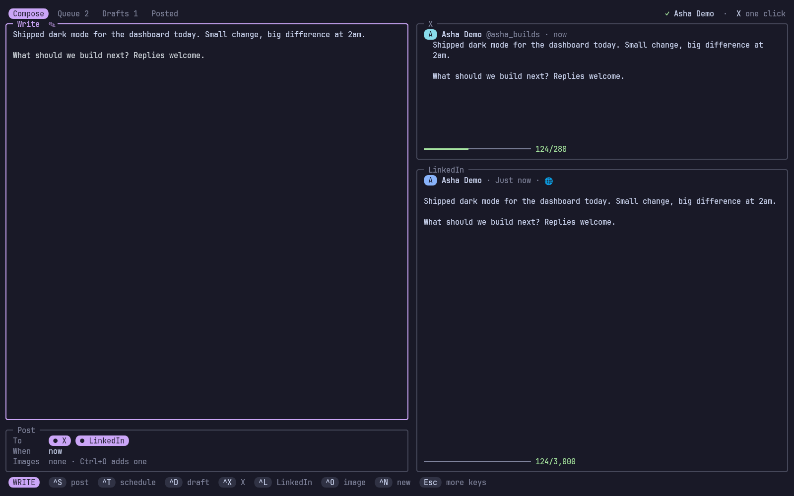
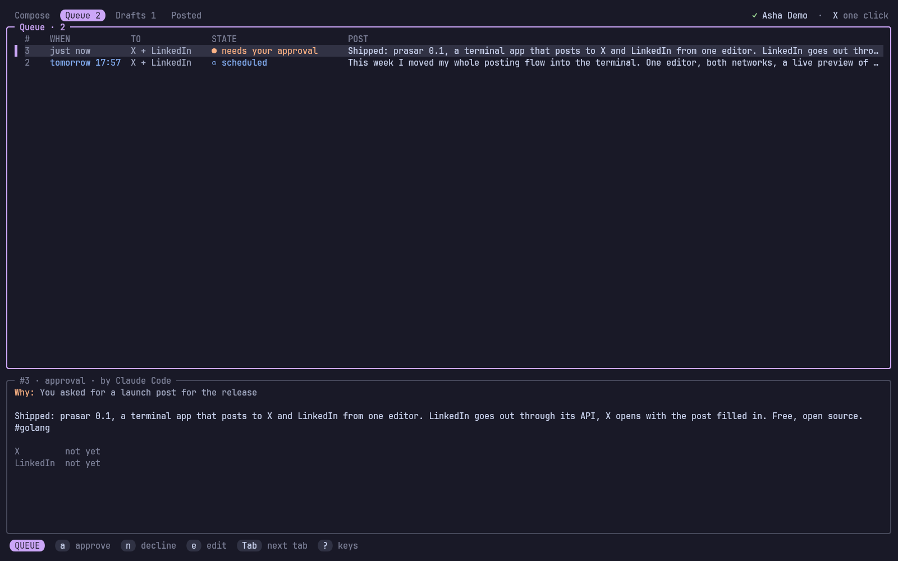

# vaikhari

**Write once, post to X and LinkedIn from the terminal.** One editor with a
live preview of how each network will show your post, drafts, a schedule,
and an AI agent that can draft posts for you (you approve every one).
**Free:** LinkedIn through its free API, X through its own share page with
one click.

<p align="center">
  
</p>
<p align="center">
  
</p>
<p align="center"><sub>Screenshots use <code>vaikhari demo</code>: a made-up account.</sub></p>

> *Vaikhari* (वैखरी) is Sanskrit for "spreading out, broadcast".

## Contents

- [What it does](#what-it-does)
- [Install](#install)
- [Set up LinkedIn](#set-up-linkedin)
- [Posting to X: one click](#posting-to-x-one-click)
- [The screen](#the-screen)
- [Keys](#keys)
- [From the shell](#from-the-shell)
- [The schedule](#the-schedule)
- [For AI agents (MCP)](#for-ai-agents-mcp)
- [Configuration](#configuration)
- [Files](#files)
- [How it works](#how-it-works)
- [Troubleshooting](#troubleshooting)
- [License](#license)

## What it does

- **One editor, two previews.** Write on the left; on the right, the post as
  X shows it (with X's own count: links are 23, CJK and emoji 2) and as
  LinkedIn's feed shows it (folded where "…see more" cuts it), each with a
  meter that turns yellow near the limit.
- **Threads.** A post longer than X's 280 becomes a thread, split at
  sentence ends and numbered `1/3`, or split it yourself with a line
  holding only `---`. On LinkedIn those lines become paragraph breaks, so
  the same text is one post there.
- **LinkedIn posts by itself** through its free API, images included, and
  `#words` become real hashtags.
- **X with one click**: vaikhari opens X's share page with the post filled in,
  you press Post. Images go to your clipboard to paste. Why: X's API costs
  money per post since 2026 ([ADR 2](docs/adr/0002-x-through-its-share-page.md)).
- **Drafts, a schedule, history**: tabs for Compose, Queue (waiting and
  scheduled), Drafts and Posted, with each post's links.
- **Never lose a post**: closing the screen keeps what you wrote as a draft.
- **Agents draft, you decide**: `vaikhari mcp` lets Claude Code (or any MCP
  agent) check, draft and propose posts; every one waits for your approval
  in a popup, where you can edit it ([ADR 3](docs/adr/0003-agents-always-ask.md)).
- **Looks like the rest of your terminal**: rounded boxes and key caps like
  narada, pattan and nauka, in your [varna](https://github.com/Theyashsawarkar/varna)
  theme's colours (Catppuccin Mocha without it), changing live.

## Install

With [kosha](https://github.com/Theyashsawarkar/kosha):

```sh
kosha install vaikhari
```

Or with the installer, which downloads the release binary into
`~/.local/share/vaikhari` (or builds it with Go) and links `~/.local/bin/vaikhari`:

```sh
curl -fsSL https://raw.githubusercontent.com/Theyashsawarkar/vaikhari/main/install.sh | bash
```

From source: `make && make install` (Go 1.26+).

**As a tmux plugin** ([TPM](https://github.com/tmux-plugins/tpm)), `prefix B`
opens it in a popup:

```tmux
set -g @plugin 'Theyashsawarkar/vaikhari'
```

The plugin runs the `vaikhari` on your PATH, or builds its own copy with Go the
first time.

Optional: `wl-clipboard` (Wayland) or `xclip` (X11) for images on X and
copying links, `notify-send` (libnotify) for notifications, `secret-tool`
(libsecret) to keep the LinkedIn sign-in in your keyring.

Try it first without any account: `vaikhari demo` runs it with a fake
LinkedIn in a throwaway folder (nothing is posted, X isn't opened).

## Set up LinkedIn

vaikhari posts to LinkedIn through an app of your own: free, self-serve, about
two minutes, once ([ADR 4](docs/adr/0004-linkedin-through-your-own-app.md)).

```sh
vaikhari auth linkedin --setup
```

It walks you through it:

1. At [linkedin.com/developers/apps/new](https://www.linkedin.com/developers/apps/new)
   create an app: any name, a LinkedIn page as its company (LinkedIn needs
   one; one you create works) and a logo.
2. On the **Products** tab add **Share on LinkedIn** and **Sign In with
   LinkedIn using OpenID Connect** (both approved at once).
3. On the **Auth** tab add `http://localhost:8723/callback` to "Authorized
   redirect URLs", and copy the Client ID and Primary Client Secret into
   vaikhari.

Then your browser opens on LinkedIn's sign-in. LinkedIn's sign-in lasts
**60 days** and can't be renewed silently: the screen's top right shows the
days left, turning yellow in the last week, and `L` (or `vaikhari auth
linkedin`) signs in again.

vaikhari posts to your personal profile. Company pages need LinkedIn's
review and aren't supported.

## Posting to X: one click

X has no free API any more, so vaikhari never logs in to X. When a post goes
out:

1. X's share page opens in your browser with the post filled in (the first
   image, if any, is on your clipboard: `Ctrl+V` pastes it).
2. You press **Post** there.
3. Back in vaikhari, press `Enter`. Paste the post's link first if you want
   it kept; for a thread, the link makes the next part a reply to it.

`Esc` leaves it for later (it waits in Queue, `o` opens it again);
`Ctrl+K` skips X for that post. A scheduled X post can't go out without
you: at its time a notification offers to open it.

## The screen

`vaikhari` (or `prefix B` in tmux) opens on **Compose**, in the editor:

- **Compose**: the editor, the "Post" box (where it goes: `Ctrl+X` /
  `Ctrl+L`; when; images), and the X and LinkedIn previews. Under 100
  columns the previews give way to their counts.
- **Queue**: what's waiting on you (an agent's post to approve, an X post
  to click, a LinkedIn post that failed) and the schedule, soonest first,
  with the selected post in full below. The footer shows the keys for that
  post.
- **Drafts**: posts you kept; `e` edits one, `p` posts it, `t` schedules it.
- **Posted**: what went out, with its links; `v` opens one, `y` copies it.

The top right says who LinkedIn posts as (and days left) and that X is one
click. Tabs count what's in Queue and Drafts.

## Keys

`?` in the screen shows them all.

**While writing**

| Key | Action |
|---|---|
| `Ctrl+S` | Post it now (LinkedIn goes out, X opens in your browser; asks first) |
| `Ctrl+T` | Schedule it (tomorrow 9am, fri 6pm, in 2h...) |
| `Ctrl+D` | Save it as a draft |
| `Ctrl+X` | Toggle posting to X |
| `Ctrl+L` | Toggle posting to LinkedIn |
| `Ctrl+O` | Add an image (a path; Ctrl+O on an empty line removes them) |
| `Ctrl+N` | Start a new post (the current one stays as it was saved) |
| `Esc` | Leave the editor (the other keys work then) |

**Compose, outside the editor**

| Key | Action |
|---|---|
| `i / Enter` | Edit the post |

**Everywhere (outside the editor)**

| Key | Action |
|---|---|
| `Tab / Shift+Tab` | Switch to the next / previous tab |
| `1 – 4` | Switch to Compose, Queue, Drafts or Posted |
| `L` | Open LinkedIn's sign-in again (it lasts 60 days) |
| `?` | Show every key |
| `q` | Quit |

**Queue, Drafts and Posted**

| Key | Action |
|---|---|
| `j / k` | Move to the next / previous post |
| `Enter / e` | Edit the post in Compose |
| `p` | Post it now (asks first) |
| `t` | Schedule it, or move it to another time |
| `o` | Open it on X's page to press Post (and confirm it after) |
| `a` | Approve an agent's post |
| `n` | Decline an agent's post |
| `r` | Send a post LinkedIn refused again |
| `c` | Cancel a scheduled or waiting post |
| `d` | Delete the draft (asks first) |
| `y` | Copy the post's link |
| `v` | Open the post's link in the browser |

**Approving an agent's post** (`vaikhari approve`, and the popup an agent's post opens)

| Key | Action |
|---|---|
| `y` | Approve it as asked (posts on every network it names) |
| `1` | Approve it for LinkedIn only (when it asks for both) |
| `2` | Approve it for X only (when it asks for both) |
| `t` | Schedule it: approve it for another time |
| `e` | Edit it first (Ctrl+S approves your version, Esc comes back) |
| `p` | Show it as each network shows it, then exactly again |
| `j / k` | Scroll the post when it's longer than its frame |
| `n` | Decline it (nothing is posted, the agent is told) |
| `q / Esc` | Leave it for later (it waits in Queue) |

**While X waits for your click**

| Key | Action |
|---|---|
| `Enter` | Confirm it's posted on X (paste its link first for a thread's next part) |
| `Ctrl+O` | Open X's page again |
| `Ctrl+K` | Cancel X for this post (LinkedIn is unaffected) |
| `Esc` | Leave it for later (it waits in Queue) |

## From the shell

```sh
vaikhari post "Shipped it #golang"                 # both networks (or config's `networks`)
vaikhari post --linkedin "Only on LinkedIn"
vaikhari post --x --image shot.png "With a picture"
vaikhari post --at "fri 6pm" "Later"               # scheduled
vaikhari post --draft "Not yet"
echo "From a file" | vaikhari post -               # text on stdin
vaikhari check "Will this fit?"                    # X count and thread, LinkedIn count and fold
vaikhari list [draft|scheduled|approval|ready|posted|failed]
vaikhari approve [ID]                              # an agent's post (the oldest waiting)
```

| Command | What it does |
|---|---|
| `vaikhari` | The screen (`--popup KEY`: in a tmux popup, `KEY` closes it) |
| `vaikhari post TEXT` | Post (`--x`, `--linkedin`, `--at WHEN`, `--image PATH` repeated, `--draft`); for X it opens the page and asks you to confirm |
| `vaikhari check TEXT` | How the text fits each network |
| `vaikhari list [STATUS]` | Your posts, one per line |
| `vaikhari approve [ID]` | Answer an agent's post |
| `vaikhari auth linkedin [--setup]` | Sign in to LinkedIn (`--setup`: enter the app's id and secret) |
| `vaikhari auth status` / `logout` | What's signed in / sign out of LinkedIn |
| `vaikhari service install\|remove\|status` | The background service that publishes scheduled posts |
| `vaikhari daemon` | The same, in the foreground |
| `vaikhari mcp [--requester NAME]` | The MCP server for agents (stdio) |
| `vaikhari doctor` | Check the setup: LinkedIn, clipboard, notifications, the service |
| `vaikhari demo` | Try it with a fake LinkedIn |
| `vaikhari keybindings` | The keys, for Vayu's keybinding search |
| `vaikhari --version` | The version |

Times (`--at`, `Ctrl+T`, `t`) read the way people write them: `in 2h`,
`tomorrow 9am`, `fri 6pm`, `next tue 10:00`, `tonight`, `3 nov 10:30`,
`2026-11-03 18:00`. A day without a time means 9:00.

## The schedule

Scheduled posts go out while vaikhari runs (the screen, `vaikhari mcp`), or at
any time with the background service:

```sh
vaikhari service install      # ~/.config/systemd/user/vaikhari.service, started now and at login
journalctl --user -u vaikhari -f
```

At a post's time, LinkedIn goes out by itself and you get a notification;
X waits for you (the notification's "Open in browser" opens it). A post is
claimed before it's sent, so the screen, the MCP server and the service
never publish one twice.

## For AI agents (MCP)

```sh
claude mcp add --scope user vaikhari -- vaikhari mcp --requester "Claude Code"
```

| Tool | What it does |
|---|---|
| `post_check` | Lengths, X's thread split, LinkedIn's fold: to fit a post before proposing it |
| `post_draft` | Save a draft you finish in vaikhari |
| `post_publish` | Propose a post, now or `send_at` later: **you approve it first** (a tmux popup on the agent's pane, and a notification), and may edit or decline it; the call waits up to 10 minutes and reports what happened |
| `post_list` | Your posts and their links |
| `post_accounts` | LinkedIn's sign-in and days left; X's one click |

The approval reads as one sentence ("Claude Code wants to post publicly, as
you, on 2 networks"), then what you asked and labels for what's at stake
(public, images, now or when). Beside the post, exactly as it goes (with
where LinkedIn folds it and where X's thread breaks marked), each network's
facts: who it posts as, its length against the limit, where LinkedIn's "see
more" cuts it, X's thread, how it goes out. `p` shows it as each network
will; `1` / `2` approve it for one network, `t` for another time. After you
answer, the popup says what happened and closes. Narrow, the facts stack
above the post.

Agents never post on their own, and are told X needs your click. What they
did is logged in `~/.local/state/vaikhari/agent.log`.

## Configuration

`~/.config/vaikhari/config.toml` (written by `vaikhari auth linkedin --setup`,
private to you):

```toml
networks = ["x", "linkedin"]   # ticked in a new post

[linkedin]
client_id = "..."
client_secret = "..."
port = 8723                    # the redirect: http://localhost:<port>/callback
version = "202607"             # LinkedIn API version (YYYYMM); LinkedIn retires each after about a year

[x]
name = "Your Name"             # shown in the X preview (default: your LinkedIn name)
handle = "you"                 # shown as @you in the X preview
```

| Environment | What it does |
|---|---|
| `VAIKHARI_HOME` | Keep config, posts and state under one folder |
| `VAIKHARI_OPENER` | The program that opens links (default `xdg-open`) |
| `VAIKHARI_NO_KEYRING` | Keep the LinkedIn sign-in in a file, not the keyring |
| `VAIKHARI_LINKEDIN_URL` | Talk to another LinkedIn (the tests' fake) |
| `NO_NERD_FONT` | Square key caps instead of Nerd Font round ones |

tmux plugin options (set before TPM's `run` line):

| Option | Default | What it does |
|---|---|---|
| `@vaikhari-key` | `B` | Key after the prefix (`none`: no key) |
| `@vaikhari-width` / `@vaikhari-height` | `90%` / `88%` | Popup size |
| `@vaikhari-title` | ` vaikhari ` | Popup title |
| `@vaikhari-launcher` | | Your own popup command instead of `display-popup` |

## Files

| Path | What |
|---|---|
| `~/.config/vaikhari/config.toml` | Settings and your LinkedIn app (0600) |
| `~/.local/share/vaikhari/vaikhari.db` | Your posts (SQLite, 0600) |
| keyring, or `~/.local/share/vaikhari/linkedin.token` | The LinkedIn sign-in |
| `~/.local/state/vaikhari/agent.log` | What agents asked for, and your answers |
| `~/.config/systemd/user/vaikhari.service` | The background service (`service install`) |

## How it works

One Go binary: the screen ([Bubble Tea](https://github.com/charmbracelet/bubbletea)),
the CLI, the MCP server and the service share `internal/app`, which keeps
posts in SQLite and moves them between `draft`, `approval`, `scheduled`,
`ready` (X waits for your click), `posted`, `failed`, `cancelled` and
`declined` only through checked transitions. `internal/post` knows each
network's rules (X's weighted count and thread splitting, LinkedIn's
"little text" escaping and hashtags), `internal/linkedin` the API, and
`internal/fake` a fake LinkedIn for the tests and `vaikhari demo`. Decisions
are recorded in [docs/adr](docs/adr/).

## Troubleshooting

- **LinkedIn: "refused the sign-in"** — the 60 days ran out or the app
  changed: `vaikhari auth linkedin`.
- **LinkedIn: "the app may not do this"** — add the **Share on LinkedIn**
  product to the app.
- **LinkedIn: "retired this API version"** — set `linkedin.version` in
  config.toml to a recent month (`YYYYMM`, a few months back).
- **"can't listen on port 8723"** — something else uses it: set
  `linkedin.port` and the app's redirect URL to another port.
- **X: the image isn't there** — X's share page can't take images: paste
  it (`Ctrl+V`); vaikhari copied it when the page opened (needs wl-copy or xclip).
- **A scheduled post didn't go out** — nothing was running at its time:
  `vaikhari service install`. `vaikhari doctor` checks it all.

## License

[MIT](LICENSE)
